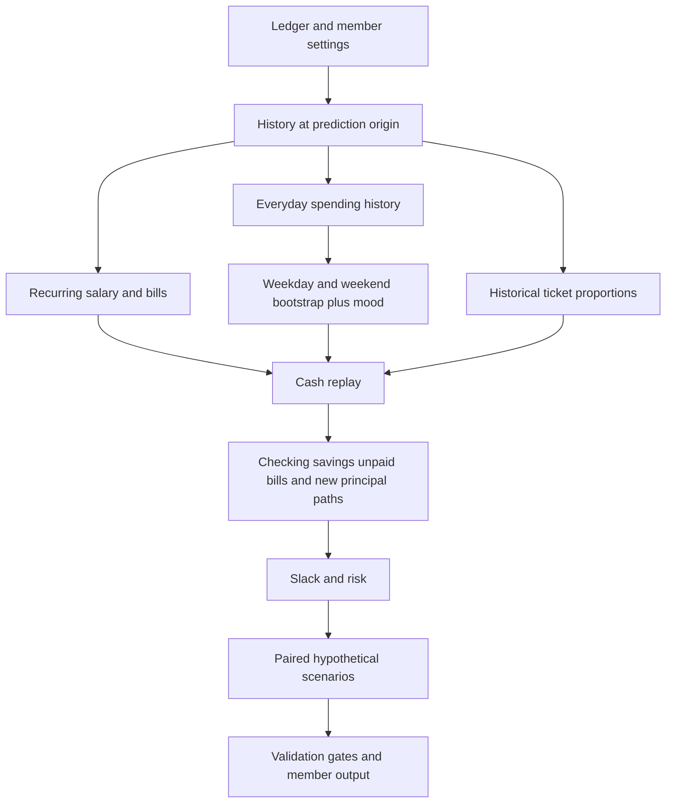

# Approach 1 Bootstrap and shared cash replay

This guide describes the repaired implementation. The previous numerical claims are superseded by [the regenerated report](../output/approach1/REPORT.md).

## Flow

## Historical preparation

`MemberHistory.UpTo` limits transactions to the forecast origin. `RecurringDetector` infers weekly, biweekly, twice-monthly and monthly events. Last-business-day payroll has its own flag; month-boundary weekend shifts are included. Holidays are not modelled.

`EverydaySeries` removes detected recurring descriptions, fees and transfers. The balance-based healthy-day heuristic and trailing imputation are retained. They estimate attempted spending from posted data; this is not observed decline data.

`BootstrapForecaster` samples historical weekday/weekend amounts and a persistent spending multiplier. It generates daily totals, not individual authorizations. `BaselineBuilder` separately samples historical within-day card proportions and fixes them for all scenarios. A day with a total of $80 and two equal ticket proportions becomes two $40 purchase attempts, not one partially payable $80 aggregate.

Ticket proportions are an explicit model assumption. They preserve whole-purchase semantics but do not reconstruct the actual future transaction count or order. When no usable pattern exists, the fallback is one ticket. Cents are rounded without allowing the allocated total to exceed the day's total.

## Accounting and replay

`Replay` keeps scheduled event keys, categories and channels. Inflows post before outflows. Non-card bills are processed largest first, followed by scheduled cards and sampled everyday cards.

- Card events use the configured card coverage rule; ACH/internal payments use courtesy-pay rules.
- A successful transfer debits one account and credits the other. Savings coverage cannot fund a transfer back to savings.
- A declined authorization does not partially spend the member's balance.
- Savings are not drained for an authorization that still cannot succeed without coverage.
- Fees respect the configured daily cap across scheduled and sampled payments.
- Failed non-card obligations are retried up to three attempts, then retained as unpaid rather than erased. Recurring card failures remain outstanding without assuming automatic retries.
- The prototype's new loan principal changes only on actual successful funding and repayment postings. It does not model missed-payment penalties or additional accrued interest.

`ReplayResult` exposes checking, savings, unpaid-obligation and outstanding-new-principal paths. These enable regression checks on both balances and liabilities.

## Scenarios and financial metrics

Scenarios reuse the exact sampled inputs. Event edits and product changes do not rerun the spending forecaster. An identity scenario must match the baseline path for path. The input hash covers ticket proportions, account state, event metadata, random arrays, rules and indexes, and is checked before cache hits.

Slack remains derived from balances. The code separately exposes the minimum daily median balance and the median of path minima; the latter remains the decision score. That policy choice still requires agreement with Occlet.

Both cash loans and refinancing now use the complete edited scenario for the prototype affordability check. Assumed alert or discretionary-cut responses are not credited as guaranteed affordability improvements. Increased outstanding unpaid obligations prevent a plan from being automatically selected.

## Validation and results

The backtest now reports endpoint accuracy at exactly 30, 60 and 90 days, daily-window diagnostics, and minimum-balance calibration separately. Bootstrap fails the full acceptance policy on the synthetic dataset. Hypothetical plans remain in the report, but member-facing advice is withheld when model or member validation is missing or fails.

See [repair notes](03-Repairs-and-Validation.md) for tests and remaining limitations.
