# Approach 2 — LightGBM and state-space forecasters + scenario engine

Forecast origin **2026-10-27**, horizon 90 days, 2,000 simulated futures per member, seed 7. All data is illustrative.

Score used by the decision rules: **lowest TRUE slack** = on the tightest day of each simulated future, (balance − borrowed principal still owed) ÷ (average daily spend + loan repayments); the median across futures. Goal: ≥ 2.0 days.

| Member | Forecaster | Headline slack 90d | Lowest true slack | P(overdraft) | Exp. fees 90d | Waterfall |
|---|---|---:|---:|---:|---:|---|
| Asha | Bootstrap | 18.3 | 0.0 | 50% | $84 | 0.0 days baseline → +0.8 (Move phone + insurance + subscription autopay to the day after payday) → +0.8 (Trim shopping by 25% (21% of everyday spend)) → +1.8 (Ask to move the rent due date to the day after payday) → 3.4 days |
| Ben | Bootstrap | 30.6 | 11.3 | 7% | $5 | 11.3 days baseline → 11.3 days |
| Chen | Bootstrap | 62.4 | 56.7 | 0% | $0 | 56.7 days baseline → 56.7 days |
| Dee | Bootstrap | 31.9 | 14.8 | 6% | $5 | 14.8 days baseline → 14.8 days |
| Eli | Bootstrap | 2.0 | -8.7 | 100% | $268 | -8.7 days baseline → +0.9 (Ask to move the rent due date to the day after payday) → -7.8 days |
| Asha | LightGBM | 19.2 | -1.3 | 55% | $78 | -1.3 days baseline → +1.3 (Move phone + insurance + subscription autopay to the day after payday) → +0.3 (Trim shopping by 25% (21% of everyday spend)) → +0.2 (Turn on low-balance alert at $150) → +1.7 (Ask to move the rent due date to the day after payday) → 2.1 days |
| Ben | LightGBM | 29.3 | 10.1 | 12% | $7 | 10.1 days baseline → 10.1 days |
| Chen | LightGBM | 62.5 | 56.3 | 0% | $0 | 56.3 days baseline → 56.3 days |
| Dee | LightGBM | 39.4 | 15.5 | 0% | $0 | 15.5 days baseline → 15.5 days |
| Eli | LightGBM | 0.6 | -9.0 | 100% | $298 | -9.0 days baseline → +0.4 (Ask to move the rent due date to the day after payday) → -8.6 days |
| Asha | StateSpace | 16.7 | -2.1 | 64% | $90 | -2.1 days baseline → +2.1 (Move phone + insurance + subscription autopay to the day after payday) → +0.3 (Ask to move the rent due date to the day after payday) → 0.3 days |
| Ben | StateSpace | 27.3 | 8.9 | 7% | $5 | 8.9 days baseline → 8.9 days |
| Chen | StateSpace | 63.1 | 56.7 | 0% | $0 | 56.7 days baseline → 56.7 days |
| Dee | StateSpace | 30.5 | 14.3 | 0% | $0 | 14.3 days baseline → 14.3 days |
| Eli | StateSpace | 1.6 | -8.7 | 100% | $276 | -8.7 days baseline → +0.7 (Ask to move the rent due date to the day after payday) → -8.0 days |

## Back-test (rolling origins, 2 weeks apart)

| Forecaster | Horizon | Days scored | In 80% band (gate 75–85%) | Below q10 (target ≈10%) | Scaled pinball (days) | Lowest-balance below q10 |
|---|---:|---:|---:|---:|---:|---:|
| Bootstrap | 30d | 1,440 | 80% ✅ | 13% ✅ | 0.81 | 12% |
| Bootstrap | 60d | 2,880 | 80% ✅ | 14% ✅ | 1.13 | 17% |
| Bootstrap | 90d | 4,320 | 79% ✅ | 15% ✅ | 1.33 | 15% |
| LightGBM | 30d | 1,440 | 77% ✅ | 13% ✅ | 0.83 | 12% |
| LightGBM | 60d | 2,880 | 74% ❌ | 16% ❌ | 1.21 | 19% |
| LightGBM | 90d | 4,320 | 73% ❌ | 19% ❌ | 1.55 | 19% |
| LightGBM-raw | 30d | 1,440 | 56% ❌ | 21% ❌ | 0.88 | 21% |
| LightGBM-raw | 60d | 2,880 | 55% ❌ | 24% ❌ | 1.25 | 33% |
| LightGBM-raw | 90d | 4,320 | 54% ❌ | 28% ❌ | 1.54 | 29% |
| StateSpace | 30d | 1,440 | 81% ✅ | 12% ✅ | 0.80 | 8% |
| StateSpace | 60d | 2,880 | 79% ✅ | 14% ✅ | 1.10 | 17% |
| StateSpace | 90d | 4,320 | 79% ✅ | 15% ❌ | 1.27 | 21% |

## Champion selection

| Forecaster | Avg scaled pinball (days) | Low-end gate at 30/60/90d | Horizons inside 75–85% band | Champion |
|---|---:|---|---:|---|
| Bootstrap | 1.09 | PASS | 3/3 | **yes** |
| LightGBM | 1.20 | FAIL | 1/3 |  |
| StateSpace | 1.06 | FAIL | 3/3 |  |

**Bootstrap** — Bootstrap passes the low-end gate and no challenger beats it.

## Do the models agree on the recommendation?

| Member | Bootstrap | LightGBM | StateSpace | Agree |
|---|---|---|---|---|
| Asha | move_bills + trim_shopping + move_rent | move_bills + trim_shopping + alerts + move_rent | move_bills + move_rent | NO |
| Ben | (no change) | (no change) | (no change) | YES |
| Chen | (no change) | (no change) | (no change) | YES |
| Dee | (no change) | (no change) | (no change) | YES |
| Eli | move_rent | move_rent | move_rent | YES |

## LightGBM diagnostics (final fit)

- 8,097 training rows, 8,097 calibration rows, 5 members (one global model per quantile).
- Calibration rows inside the raw q10–q90 band: 51% → after conformal adjustment 80%. Spend above q90 (= balance below its q10): 27% → 10%.
- Copula: observed correlation of 7-day vs 90-day surprises 0.27 → persistent share λ = 0.00.
- Top features by gain (q50 model): `log_spend_scale` 25%, `tenure_days` 22%, `cushion_days` 8%, `spend_cv30` 8%, `overdraft_fees_90d` 6%, `income_cv` 5%.

## Asha (A) — Bootstrap

*Occlet's Member A: paid on the 8th and 23rd; rent, phone and insurance fall before payday.*

- Start balance $1,922, savings $750, average daily spend $95.05.
- Headline slack 30/60/90 d: 19.6 / 18.9 / 18.3 days. Lowest true slack: **0.0** (bad case p10 -7.4). Risk days: 19. P(any overdraft): 50%. Expected fees: $84.
- Explanation: Your balance is likely lowest on Jan 07 (about $0, 0.0 days of spending). What pulls it down: rent $1,100 on Jan 01, phone $90 on Jan 03, insurance $160 on Jan 05. Payday on Jan 08 brings it back.
- **Decision:** Goal met in tier 'Behaviour' after 3 lever(s). Structural gap: typical spending exceeds income by $178/month.
- **Waterfall:** 0.0 days baseline → +0.8 (Move phone + insurance + subscription autopay to the day after payday) → +0.8 (Trim shopping by 25% (21% of everyday spend)) → +1.8 (Ask to move the rent due date to the day after payday) → 3.4 days
- **Member sentence:** “If you move your phone, insurance and subscription autopay to the day after payday, spend about 25% less on shopping and ask your landlord to move the rent due date to the day after payday (if your landlord agrees), your tightest day over the next 90 days goes from about 0.0 to 3.4 days of spending in hand, and expected overdraft fees drop from about $84 to $31.”

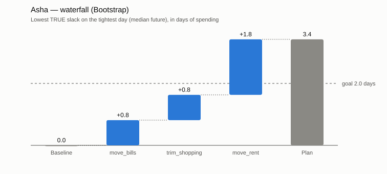

| Lever | Tier | Method | Lowest true slack | Δ vs baseline | Fees 90d | Bill declines | Gate |
|---|---|---|---:|---:|---:|---:|---|
| Move phone + insurance + subscription autopay to the day after payday | Behaviour | Exact | 0.8 | +0.8 | $30 | 0.0 |  |
| Ask to move the rent due date to the day after payday | Behaviour | Exact | 2.7 | +2.7 | $37 | 0.0 |  |
| Turn on low-balance alert at $150 | Behaviour | Learned | 0.0 | 0.0 | $82 | 0.0 |  |
| Trim shopping by 25% (21% of everyday spend) | Behaviour | Learned | 0.0 | 0.0 | $77 | 0.0 |  |
| Switch on savings-first overdraft order | Product | Exact | 0.0 | 0.0 | $28 | 0.0 |  |
| Fee-free account without courtesy pay | Product | Exact | 0.0 | 0.0 | $0 | 3.3 |  |
| $1,000 personal loan, 12 mo @ 13.99% ($90/mo) | Liquidity | Exact | -1.7 | −1.7 | $24 | 0.0 | FAIL payment $90/mo vs half of monthly surplus $0 (surplus $-178) |
| Income +10% from day 15 (e.g. extra hours) | Income | Exact | 0.8 | +0.8 | $50 | 0.0 |  |
| STRESS TEST: income −20% (member-agreed, never recommended) *(not surfaced)* | Income | Exact | -8.5 | −8.5 | $287 | 0.0 |  |

Why the other levers were not added:

- `alerts` — adds only +0.00 days (< 0.1)
- `trim_shopping` — adds only +0.00 days (< 0.1)

Catalogue notes: refinance: no outside credit-card debt on file.

## Ben (B) — Bootstrap

*Hourly worker paid every other Friday (hours vary). Low-balance alert already on.*

- Start balance $1,818, savings $0, average daily spend $82.16.
- Headline slack 30/60/90 d: 20.6 / 32.6 / 30.6 days. Lowest true slack: **11.3** (bad case p10 0.4). Risk days: 0. P(any overdraft): 7%. Expected fees: $5.
- Explanation: Your balance is likely lowest on Jan 07 (about $981, 11.9 days of spending). What pulls it down: rent $1,050 on Jan 01, insurance $140 on Jan 02, subscription $18 on Jan 06. Payday on Jan 08 brings it back.
- **Decision:** Goal already met at baseline (11.3 ≥ 2.0 days) — no lever needed.
- **Waterfall:** 11.3 days baseline → 11.3 days
- **Member sentence:** “You keep about 11.3 days of spending in hand even on your tightest day over the next 90 days — no change needed.”

| Lever | Tier | Method | Lowest true slack | Δ vs baseline | Fees 90d | Bill declines | Gate |
|---|---|---|---:|---:|---:|---:|---|
| Move phone + internet + subscription autopay to the day after payday | Behaviour | Exact | 11.4 | +0.2 | $2 | 0.0 |  |
| Ask to move the rent due date to the day after payday | Behaviour | Exact | 13.7 | +2.4 | $1 | 0.0 |  |
| Trim shopping by 25% (18% of everyday spend) | Behaviour | Learned | 11.7 | +0.4 | $5 | 0.0 |  |
| Fee-free account without courtesy pay | Product | Exact | 11.3 | 0.0 | $0 | 0.3 |  |
| $1,000 personal loan, 12 mo @ 13.99% ($90/mo) | Liquidity | Exact | 10.7 | −0.5 | $1 | 0.0 | FAIL payment $90/mo vs half of monthly surplus $9 (surplus $18) |
| Income +10% from day 15 (e.g. extra hours) | Income | Exact | 13.3 | +2.1 | $1 | 0.0 |  |
| STRESS TEST: income −20% (member-agreed, never recommended) *(not surfaced)* | Income | Exact | -0.6 | −11.9 | $64 | 0.0 |  |

Catalogue notes: alerts: already active — its effect is already in the member's history, so it is not offered again. savings_first: no savings balance to draw on. refinance: no outside credit-card debt on file.

## Chen (C) — Bootstrap

*Salaried, paid on the last business day; comfortable cushion.*

- Start balance $8,956, savings $12,800, average daily spend $154.89.
- Headline slack 30/60/90 d: 59.5 / 60.9 / 62.4 days. Lowest true slack: **56.7** (bad case p10 52.1). Risk days: 0. P(any overdraft): 0%. Expected fees: $0.
- Explanation: Your balance is likely lowest on Oct 29 (about $8,839, 57.1 days of spending). What pulls it down: everyday spending. Payday on Oct 30 brings it back.
- **Decision:** Goal already met at baseline (56.7 ≥ 2.0 days) — no lever needed.
- **Waterfall:** 56.7 days baseline → 56.7 days
- **Member sentence:** “You keep about 56.7 days of spending in hand even on your tightest day over the next 90 days — no change needed.”

| Lever | Tier | Method | Lowest true slack | Δ vs baseline | Fees 90d | Bill declines | Gate |
|---|---|---|---:|---:|---:|---:|---|
| Turn on low-balance alert at $150 | Behaviour | Learned | 56.7 | 0.0 | $0 | 0.0 |  |
| Trim shopping by 25% (22% of everyday spend) | Behaviour | Learned | 56.8 | +0.1 | $0 | 0.0 |  |
| Switch on savings-first overdraft order | Product | Exact | 56.7 | 0.0 | $0 | 0.0 |  |
| Fee-free account without courtesy pay | Product | Exact | 56.7 | 0.0 | $0 | 0.0 |  |
| $1,000 personal loan, 12 mo @ 13.99% ($90/mo) | Liquidity | Exact | 55.6 | −1.1 | $0 | 0.0 | PASS payment $90/mo vs half of monthly surplus $96 (surplus $193) |
| Income +10% from day 15 (e.g. extra hours) | Income | Exact | 56.8 | +0.1 | $0 | 0.0 |  |
| STRESS TEST: income −20% (member-agreed, never recommended) *(not surfaced)* | Income | Exact | 42.2 | −14.4 | $0 | 0.0 |  |

Catalogue notes: move_bills: no movable bill falls within 5 days before a payday. move_rent: housing payment already falls within 2 days after a payday. refinance: no outside credit-card debt on file.

## Dee (D) — Bootstrap

*New member since June 2026 — about four months of history (thin file).*

- Start balance $1,259, savings $0, average daily spend $61.27.
- Headline slack 30/60/90 d: 24.5 / 28.4 / 31.9 days. Lowest true slack: **14.8** (bad case p10 2.6). Risk days: 0. P(any overdraft): 6%. Expected fees: $5.
- Explanation: Your balance is likely lowest on Nov 12 (about $932, 15.2 days of spending). What pulls it down: insurance $95 on Nov 12. Payday on Nov 13 brings it back.
- **Decision:** Goal already met at baseline (14.8 ≥ 2.0 days) — no lever needed.
- **Waterfall:** 14.8 days baseline → 14.8 days
- **Member sentence:** “You keep about 14.8 days of spending in hand even on your tightest day over the next 90 days — no change needed.”

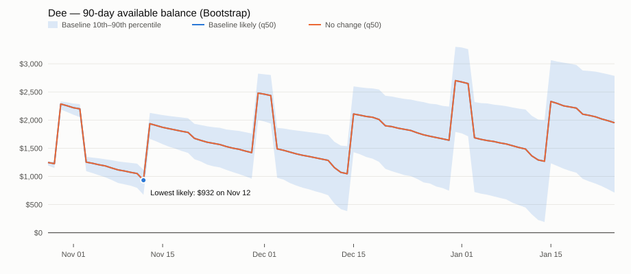

| Lever | Tier | Method | Lowest true slack | Δ vs baseline | Fees 90d | Bill declines | Gate |
|---|---|---|---:|---:|---:|---:|---|
| Move insurance + subscription + phone autopay to the day after payday | Behaviour | Exact | 16.5 | +1.7 | $0 | 0.0 |  |
| Ask to move the rent due date to the day after payday | Behaviour | Exact | 19.8 | +5.0 | $0 | 0.0 |  |
| Turn on low-balance alert at $150 | Behaviour | Learned | 14.8 | 0.0 | $5 | 0.0 |  |
| Trim shopping by 25% (25% of everyday spend) | Behaviour | Learned | 15.1 | +0.3 | $4 | 0.0 |  |
| Fee-free account without courtesy pay | Product | Exact | 14.8 | 0.0 | $0 | 0.3 |  |
| $1,000 personal loan, 12 mo @ 13.99% ($90/mo) | Liquidity | Exact | 14.0 | −0.7 | $0 | 0.0 | PASS payment $90/mo vs half of monthly surplus $96 (surplus $192) |
| Income +10% from day 15 (e.g. extra hours) | Income | Exact | 15.1 | +0.3 | $2 | 0.0 |  |
| STRESS TEST: income −20% (member-agreed, never recommended) *(not surfaced)* | Income | Exact | 3.1 | −11.7 | $37 | 0.0 |  |

Catalogue notes: savings_first: no savings balance to draw on. refinance: no outside credit-card debt on file.

## Eli (E) — Bootstrap

*Gig driver paid weekly (Tuesdays) with ±30% swings; $4,200 on an outside card at 27.99% APR.*

- Start balance $502, savings $0, average daily spend $78.10.
- Headline slack 30/60/90 d: 6.0 / 4.7 / 2.0 days. Lowest true slack: **-8.7** (bad case p10 -10.5). Risk days: 48. P(any overdraft): 100%. Expected fees: $268.
- Explanation: Your balance is likely lowest on Nov 01 (about $-669, -8.6 days of spending). What pulls it down: rent $980 on Nov 01. Payday on Nov 03 brings it back.
- **Decision:** Goal not met; best partial plan shown. Structural gap: typical spending exceeds income by $329/month.
- **Waterfall:** -8.7 days baseline → +0.9 (Ask to move the rent due date to the day after payday) → -7.8 days
- **Member sentence:** “If you ask your landlord to move the rent due date to the day after payday (if your landlord agrees), your tightest day over the next 90 days goes from about -8.7 to -7.8 days of spending in hand. Because your usual spending runs about $329 a month above your income, that is still short of the 2-day goal — worth a budget conversation with a specialist.”

| Lever | Tier | Method | Lowest true slack | Δ vs baseline | Fees 90d | Bill declines | Gate |
|---|---|---|---:|---:|---:|---:|---|
| Move phone + insurance + utilities autopay to the day after payday | Behaviour | Exact | -8.7 | 0.0 | $162 | 0.0 |  |
| Ask to move the rent due date to the day after payday | Behaviour | Exact | -7.8 | +0.9 | $269 | 0.0 |  |
| Turn on low-balance alert at $150 | Behaviour | Learned | -8.7 | 0.0 | $258 | 0.0 |  |
| Trim shopping by 25% (10% of everyday spend) | Behaviour | Learned | -8.7 | 0.0 | $265 | 0.0 |  |
| Fee-free account without courtesy pay | Product | Exact | 0.0 | +8.7 | $0 | 6.4 |  |
| $1,000 personal loan, 12 mo @ 13.99% ($90/mo) | Liquidity | Exact | -14.0 | −5.3 | $121 | 0.0 | FAIL payment $90/mo vs half of monthly surplus $0 (surplus $-329) |
| Refinance $4,200 card debt (27.99% APR) into a 36-mo CU loan @ 11.99%: $168 → $139/mo | Liquidity | Exact | -8.8 | −0.1 | $256 | 0.0 | PASS new payment $139/mo vs current $168/mo |
| Income +10% from day 15 (e.g. extra hours) | Income | Exact | -8.6 | +0.1 | $205 | 0.0 |  |
| STRESS TEST: income −20% (member-agreed, never recommended) *(not surfaced)* | Income | Exact | -9.6 | −0.9 | $429 | 0.0 |  |

Why the other levers were not added:

- `move_bills` — adds only +0.04 days (< 0.1)
- `alerts` — adds only +0.03 days (< 0.1)
- `trim_shopping` — adds only +0.03 days (< 0.1)
- `no_fee_account` — turns fees into ~5.9 declined bill payments per 90 days — needs a member conversation, not auto-adoption
- `cash_loan` — gate failed (cash_loan): payment $90/mo vs half of monthly surplus $0 (surplus $-329)
- `refinance_card` — beats the higher-priority plan by only -0.05 days (< 1.0-day margin)
- `income_up_10` — beats the higher-priority plan by only +0.33 days (< 1.0-day margin)

Catalogue notes: savings_first: no savings balance to draw on.

## Asha (A) — LightGBM

*Occlet's Member A: paid on the 8th and 23rd; rent, phone and insurance fall before payday.*

- Start balance $1,922, savings $750, average daily spend $95.05.
- Headline slack 30/60/90 d: 19.8 / 19.4 / 19.2 days. Lowest true slack: **-1.3** (bad case p10 -5.9). Risk days: 19. P(any overdraft): 55%. Expected fees: $78.
- Explanation: Your balance is likely lowest on Jan 07 (about $7, 0.1 days of spending). What pulls it down: rent $1,100 on Jan 01, phone $90 on Jan 03, insurance $160 on Jan 05. Payday on Jan 08 brings it back.
- **Decision:** Goal met in tier 'Behaviour' after 4 lever(s). Structural gap: typical spending exceeds income by $161/month.
- **Waterfall:** -1.3 days baseline → +1.3 (Move phone + insurance + subscription autopay to the day after payday) → +0.3 (Trim shopping by 25% (21% of everyday spend)) → +0.2 (Turn on low-balance alert at $150) → +1.7 (Ask to move the rent due date to the day after payday) → 2.1 days
- **Member sentence:** “If you move your phone, insurance and subscription autopay to the day after payday, spend about 25% less on shopping, turn on a low-balance alert at $150 and ask your landlord to move the rent due date to the day after payday (if your landlord agrees), your tightest day over the next 90 days goes from about -1.3 to 2.1 days of spending in hand, and expected overdraft fees drop from about $78 to $24.”

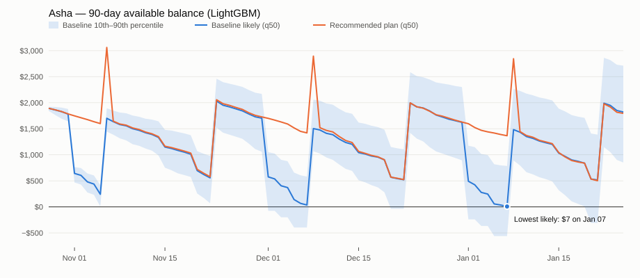

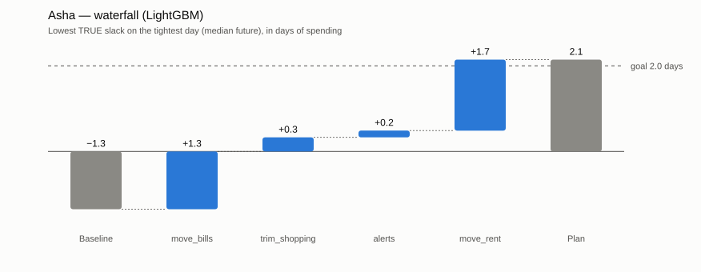

| Lever | Tier | Method | Lowest true slack | Δ vs baseline | Fees 90d | Bill declines | Gate |
|---|---|---|---:|---:|---:|---:|---|
| Move phone + insurance + subscription autopay to the day after payday | Behaviour | Exact | 0.0 | +1.3 | $24 | 0.0 |  |
| Ask to move the rent due date to the day after payday | Behaviour | Exact | 1.4 | +2.8 | $28 | 0.0 |  |
| Turn on low-balance alert at $150 | Behaviour | Learned | -1.2 | +0.1 | $74 | 0.0 |  |
| Trim shopping by 25% (21% of everyday spend) | Behaviour | Learned | -0.7 | +0.6 | $68 | 0.0 |  |
| Switch on savings-first overdraft order | Product | Exact | 0.0 | +1.3 | $17 | 0.0 |  |
| Fee-free account without courtesy pay | Product | Exact | 0.0 | +1.3 | $0 | 3.0 |  |
| $1,000 personal loan, 12 mo @ 13.99% ($90/mo) | Liquidity | Exact | -2.7 | −1.3 | $12 | 0.0 | FAIL payment $90/mo vs half of monthly surplus $0 (surplus $-161) |
| Income +10% from day 15 (e.g. extra hours) | Income | Exact | 0.0 | +1.3 | $36 | 0.0 |  |
| STRESS TEST: income −20% (member-agreed, never recommended) *(not surfaced)* | Income | Exact | -8.7 | −7.3 | $276 | 0.0 |  |

Why the other levers were not added:

- `alerts` — adds only +0.00 days (< 0.1)
- `trim_shopping` — behaviour lever adds +0.64 days

Catalogue notes: refinance: no outside credit-card debt on file.

## Ben (B) — LightGBM

*Hourly worker paid every other Friday (hours vary). Low-balance alert already on.*

- Start balance $1,818, savings $0, average daily spend $82.16.
- Headline slack 30/60/90 d: 20.0 / 31.8 / 29.3 days. Lowest true slack: **10.1** (bad case p10 -0.6). Risk days: 2. P(any overdraft): 12%. Expected fees: $7.
- Explanation: Your balance is likely lowest on Jan 07 (about $937, 11.4 days of spending). What pulls it down: rent $1,050 on Jan 01, insurance $140 on Jan 02, subscription $18 on Jan 06. Payday on Jan 08 brings it back.
- **Decision:** Goal already met at baseline (10.1 ≥ 2.0 days) — no lever needed. Structural gap: typical spending exceeds income by $52/month.
- **Waterfall:** 10.1 days baseline → 10.1 days
- **Member sentence:** “You keep about 10.1 days of spending in hand even on your tightest day over the next 90 days — no change needed.”

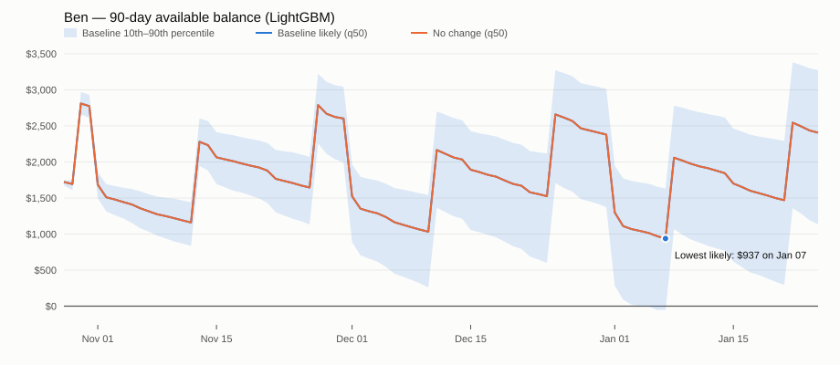

| Lever | Tier | Method | Lowest true slack | Δ vs baseline | Fees 90d | Bill declines | Gate |
|---|---|---|---:|---:|---:|---:|---|
| Move phone + internet + subscription autopay to the day after payday | Behaviour | Exact | 10.3 | +0.1 | $3 | 0.0 |  |
| Ask to move the rent due date to the day after payday | Behaviour | Exact | 12.8 | +2.6 | $1 | 0.0 |  |
| Trim shopping by 25% (18% of everyday spend) | Behaviour | Learned | 10.6 | +0.5 | $6 | 0.0 |  |
| Fee-free account without courtesy pay | Product | Exact | 10.1 | 0.0 | $0 | 0.4 |  |
| $1,000 personal loan, 12 mo @ 13.99% ($90/mo) | Liquidity | Exact | 9.7 | −0.5 | $0 | 0.0 | FAIL payment $90/mo vs half of monthly surplus $0 (surplus $-52) |
| Income +10% from day 15 (e.g. extra hours) | Income | Exact | 12.5 | +2.4 | $1 | 0.0 |  |
| STRESS TEST: income −20% (member-agreed, never recommended) *(not surfaced)* | Income | Exact | -0.6 | −10.8 | $70 | 0.0 |  |

Catalogue notes: alerts: already active — its effect is already in the member's history, so it is not offered again. savings_first: no savings balance to draw on. refinance: no outside credit-card debt on file.

## Chen (C) — LightGBM

*Salaried, paid on the last business day; comfortable cushion.*

- Start balance $8,956, savings $12,800, average daily spend $154.89.
- Headline slack 30/60/90 d: 59.7 / 61.2 / 62.5 days. Lowest true slack: **56.3** (bad case p10 49.5). Risk days: 0. P(any overdraft): 0%. Expected fees: $0.
- Explanation: Your balance is likely lowest on Oct 29 (about $8,832, 57.0 days of spending). What pulls it down: everyday spending. Payday on Oct 30 brings it back.
- **Decision:** Goal already met at baseline (56.3 ≥ 2.0 days) — no lever needed.
- **Waterfall:** 56.3 days baseline → 56.3 days
- **Member sentence:** “You keep about 56.3 days of spending in hand even on your tightest day over the next 90 days — no change needed.”

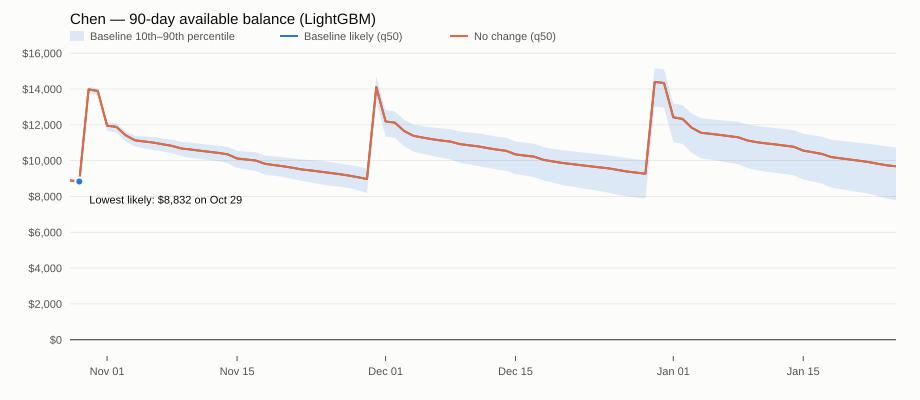

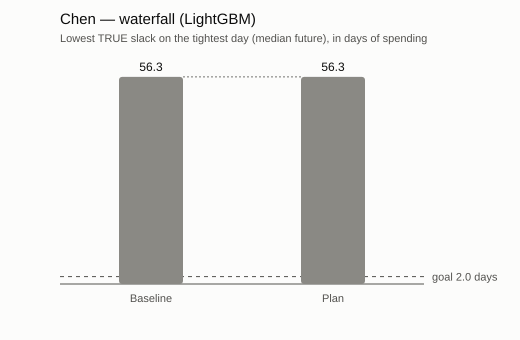

| Lever | Tier | Method | Lowest true slack | Δ vs baseline | Fees 90d | Bill declines | Gate |
|---|---|---|---:|---:|---:|---:|---|
| Turn on low-balance alert at $150 | Behaviour | Learned | 56.3 | 0.0 | $0 | 0.0 |  |
| Trim shopping by 25% (22% of everyday spend) | Behaviour | Learned | 56.5 | +0.2 | $0 | 0.0 |  |
| Switch on savings-first overdraft order | Product | Exact | 56.3 | 0.0 | $0 | 0.0 |  |
| Fee-free account without courtesy pay | Product | Exact | 56.3 | 0.0 | $0 | 0.0 |  |
| $1,000 personal loan, 12 mo @ 13.99% ($90/mo) | Liquidity | Exact | 55.2 | −1.1 | $0 | 0.0 | FAIL payment $90/mo vs half of monthly surplus $73 (surplus $145) |
| Income +10% from day 15 (e.g. extra hours) | Income | Exact | 56.6 | +0.3 | $0 | 0.0 |  |
| STRESS TEST: income −20% (member-agreed, never recommended) *(not surfaced)* | Income | Exact | 42.1 | −14.2 | $0 | 0.0 |  |

Catalogue notes: move_bills: no movable bill falls within 5 days before a payday. move_rent: housing payment already falls within 2 days after a payday. refinance: no outside credit-card debt on file.

## Dee (D) — LightGBM

*New member since June 2026 — about four months of history (thin file).*

- Start balance $1,259, savings $0, average daily spend $61.27.
- Headline slack 30/60/90 d: 27.1 / 33.4 / 39.4 days. Lowest true slack: **15.5** (bad case p10 7.2). Risk days: 0. P(any overdraft): 0%. Expected fees: $0.
- Explanation: Your balance is likely lowest on Nov 12 (about $1,011, 16.5 days of spending). What pulls it down: insurance $95 on Nov 12. Payday on Nov 13 brings it back.
- **Decision:** Goal already met at baseline (15.5 ≥ 2.0 days) — no lever needed.
- **Waterfall:** 15.5 days baseline → 15.5 days
- **Member sentence:** “You keep about 15.5 days of spending in hand even on your tightest day over the next 90 days — no change needed.”

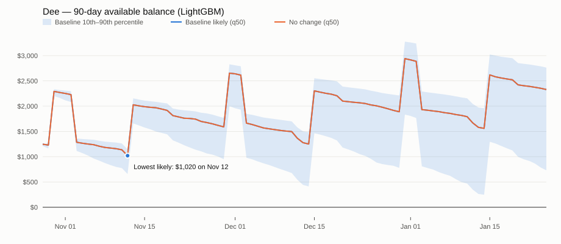

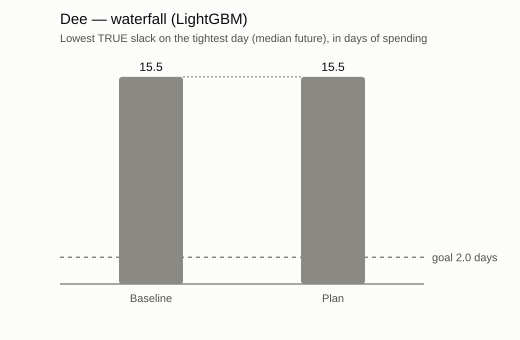

| Lever | Tier | Method | Lowest true slack | Δ vs baseline | Fees 90d | Bill declines | Gate |
|---|---|---|---:|---:|---:|---:|---|
| Move insurance + subscription + phone autopay to the day after payday | Behaviour | Exact | 17.2 | +1.7 | $0 | 0.0 |  |
| Ask to move the rent due date to the day after payday | Behaviour | Exact | 19.7 | +4.3 | $0 | 0.0 |  |
| Turn on low-balance alert at $150 | Behaviour | Learned | 15.5 | 0.0 | $0 | 0.0 |  |
| Trim shopping by 25% (25% of everyday spend) | Behaviour | Learned | 15.8 | +0.4 | $0 | 0.0 |  |
| Fee-free account without courtesy pay | Product | Exact | 15.5 | 0.0 | $0 | 0.0 |  |
| $1,000 personal loan, 12 mo @ 13.99% ($90/mo) | Liquidity | Exact | 14.7 | −0.8 | $0 | 0.0 | PASS payment $90/mo vs half of monthly surplus $135 (surplus $270) |
| Income +10% from day 15 (e.g. extra hours) | Income | Exact | 16.1 | +0.7 | $0 | 0.0 |  |
| STRESS TEST: income −20% (member-agreed, never recommended) *(not surfaced)* | Income | Exact | 7.1 | −8.4 | $26 | 0.0 |  |

Catalogue notes: savings_first: no savings balance to draw on. refinance: no outside credit-card debt on file.

## Eli (E) — LightGBM

*Gig driver paid weekly (Tuesdays) with ±30% swings; $4,200 on an outside card at 27.99% APR.*

- Start balance $502, savings $0, average daily spend $78.10.
- Headline slack 30/60/90 d: 5.4 / 3.4 / 0.6 days. Lowest true slack: **-9.0** (bad case p10 -10.8). Risk days: 52. P(any overdraft): 100%. Expected fees: $298.
- Explanation: Your balance is likely lowest on Nov 01 (about $-690, -8.8 days of spending). What pulls it down: rent $980 on Nov 01. Payday on Nov 03 brings it back.
- **Decision:** Goal not met; best partial plan shown. Structural gap: typical spending exceeds income by $484/month.
- **Waterfall:** -9.0 days baseline → +0.4 (Ask to move the rent due date to the day after payday) → -8.6 days
- **Member sentence:** “If you ask your landlord to move the rent due date to the day after payday (if your landlord agrees), your tightest day over the next 90 days goes from about -9.0 to -8.6 days of spending in hand. Because your usual spending runs about $484 a month above your income, that is still short of the 2-day goal — worth a budget conversation with a specialist.”

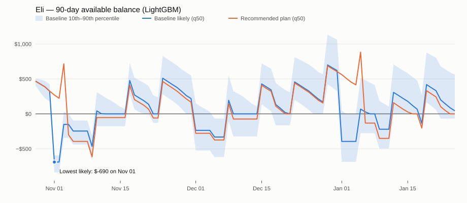

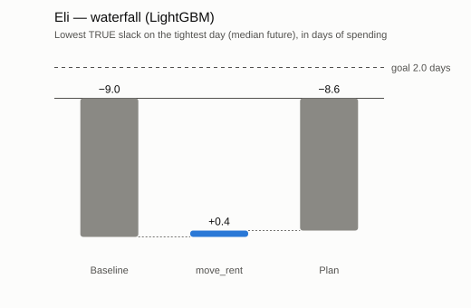

| Lever | Tier | Method | Lowest true slack | Δ vs baseline | Fees 90d | Bill declines | Gate |
|---|---|---|---:|---:|---:|---:|---|
| Move phone + insurance + utilities autopay to the day after payday | Behaviour | Exact | -9.0 | 0.0 | $190 | 0.0 |  |
| Ask to move the rent due date to the day after payday | Behaviour | Exact | -8.6 | +0.4 | $300 | 0.0 |  |
| Turn on low-balance alert at $150 | Behaviour | Learned | -8.9 | 0.0 | $282 | 0.0 |  |
| Trim shopping by 25% (10% of everyday spend) | Behaviour | Learned | -8.9 | 0.0 | $295 | 0.0 |  |
| Fee-free account without courtesy pay | Product | Exact | 0.0 | +9.0 | $0 | 7.3 |  |
| $1,000 personal loan, 12 mo @ 13.99% ($90/mo) | Liquidity | Exact | -15.7 | −6.7 | $167 | 0.0 | FAIL payment $90/mo vs half of monthly surplus $0 (surplus $-484) |
| Refinance $4,200 card debt (27.99% APR) into a 36-mo CU loan @ 11.99%: $168 → $139/mo | Liquidity | Exact | -9.1 | −0.1 | $287 | 0.0 | PASS new payment $139/mo vs current $168/mo |
| Income +10% from day 15 (e.g. extra hours) | Income | Exact | -8.9 | +0.1 | $233 | 0.0 |  |
| STRESS TEST: income −20% (member-agreed, never recommended) *(not surfaced)* | Income | Exact | -10.0 | −1.0 | $446 | 0.0 |  |

Why the other levers were not added:

- `move_bills` — adds only +0.02 days (< 0.1)
- `alerts` — adds only +0.03 days (< 0.1)
- `trim_shopping` — adds only +0.03 days (< 0.1)
- `no_fee_account` — turns fees into ~7.1 declined bill payments per 90 days — needs a member conversation, not auto-adoption
- `cash_loan` — gate failed (cash_loan): payment $90/mo vs half of monthly surplus $0 (surplus $-484)
- `refinance_card` — beats the higher-priority plan by only -0.06 days (< 1.0-day margin)
- `income_up_10` — beats the higher-priority plan by only +0.45 days (< 1.0-day margin)

Catalogue notes: savings_first: no savings balance to draw on.

## Asha (A) — StateSpace

*Occlet's Member A: paid on the 8th and 23rd; rent, phone and insurance fall before payday.*

- Start balance $1,922, savings $750, average daily spend $95.05.
- Headline slack 30/60/90 d: 19.0 / 17.9 / 16.7 days. Lowest true slack: **-2.1** (bad case p10 -7.0). Risk days: 20. P(any overdraft): 64%. Expected fees: $90.
- Explanation: Your balance is likely lowest on Jan 05 (about $-96, -1.0 days of spending). What pulls it down: rent $1,100 on Jan 01, phone $90 on Jan 03, insurance $160 on Jan 05. Payday on Jan 08 brings it back.
- **Decision:** Goal not met; best partial plan shown. Structural gap: typical spending exceeds income by $235/month.
- **Waterfall:** -2.1 days baseline → +2.1 (Move phone + insurance + subscription autopay to the day after payday) → +0.3 (Ask to move the rent due date to the day after payday) → 0.3 days
- **Member sentence:** “If you move your phone, insurance and subscription autopay to the day after payday and ask your landlord to move the rent due date to the day after payday (if your landlord agrees), your tightest day over the next 90 days goes from about -2.1 to 0.3 days of spending in hand, and expected overdraft fees drop from about $90 to $33. Because your usual spending runs about $235 a month above your income, that is still short of the 2-day goal — worth a budget conversation with a specialist.”

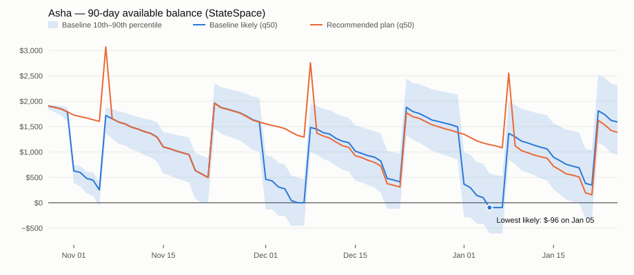

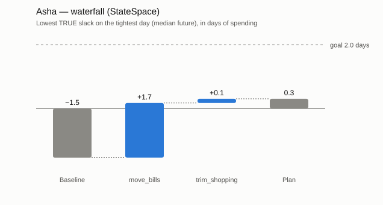

| Lever | Tier | Method | Lowest true slack | Δ vs baseline | Fees 90d | Bill declines | Gate |
|---|---|---|---:|---:|---:|---:|---|
| Move phone + insurance + subscription autopay to the day after payday | Behaviour | Exact | 0.0 | +2.1 | $29 | 0.0 |  |
| Ask to move the rent due date to the day after payday | Behaviour | Exact | 0.3 | +2.3 | $35 | 0.0 |  |
| Turn on low-balance alert at $150 | Behaviour | Learned | -2.1 | 0.0 | $87 | 0.0 |  |
| Trim shopping by 25% (21% of everyday spend) | Behaviour | Learned | -1.6 | +0.4 | $81 | 0.0 |  |
| Switch on savings-first overdraft order | Product | Exact | 0.0 | +2.1 | $23 | 0.0 |  |
| Fee-free account without courtesy pay | Product | Exact | 0.0 | +2.1 | $0 | 3.8 |  |
| $1,000 personal loan, 12 mo @ 13.99% ($90/mo) | Liquidity | Exact | -4.0 | −1.9 | $17 | 0.0 | FAIL payment $90/mo vs half of monthly surplus $0 (surplus $-235) |
| Income +10% from day 15 (e.g. extra hours) | Income | Exact | 0.0 | +2.1 | $49 | 0.0 |  |
| STRESS TEST: income −20% (member-agreed, never recommended) *(not surfaced)* | Income | Exact | -9.1 | −7.1 | $314 | 0.0 |  |

Why the other levers were not added:

- `alerts` — adds only +0.00 days (< 0.1)
- `trim_shopping` — adds only +0.00 days (< 0.1)
- `savings_first` — beats the higher-priority plan by only +0.00 days (< 1.0-day margin)
- `no_fee_account` — turns fees into ~2.2 declined bill payments per 90 days — needs a member conversation, not auto-adoption
- `cash_loan` — gate failed (cash_loan): payment $90/mo vs half of monthly surplus $0 (surplus $-235)
- `income_up_10` — gain positive in only 72% of futures (< 80% confidence)

Catalogue notes: refinance: no outside credit-card debt on file.

## Ben (B) — StateSpace

*Hourly worker paid every other Friday (hours vary). Low-balance alert already on.*

- Start balance $1,818, savings $0, average daily spend $82.16.
- Headline slack 30/60/90 d: 19.5 / 30.5 / 27.3 days. Lowest true slack: **8.9** (bad case p10 0.4). Risk days: 0. P(any overdraft): 7%. Expected fees: $5.
- Explanation: Your balance is likely lowest on Jan 07 (about $784, 9.5 days of spending). What pulls it down: rent $1,050 on Jan 01, insurance $140 on Jan 02, subscription $18 on Jan 06. Payday on Jan 08 brings it back.
- **Decision:** Goal already met at baseline (8.9 ≥ 2.0 days) — no lever needed. Structural gap: typical spending exceeds income by $73/month.
- **Waterfall:** 8.9 days baseline → 8.9 days
- **Member sentence:** “You keep about 8.9 days of spending in hand even on your tightest day over the next 90 days — no change needed.”

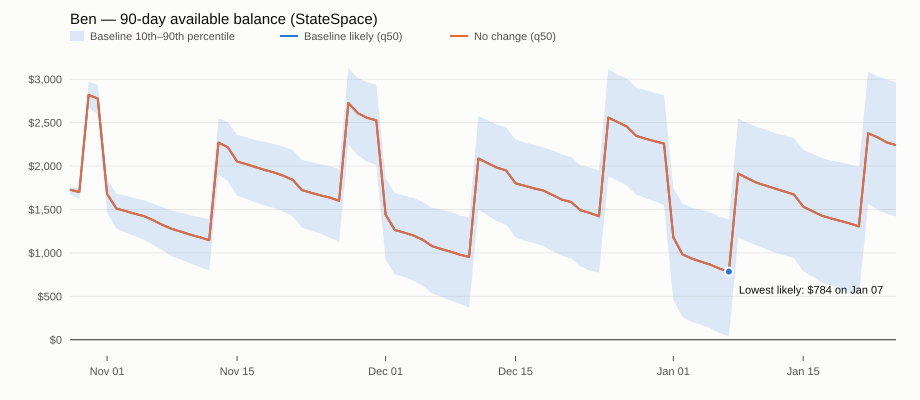

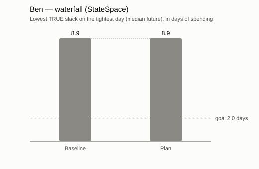

| Lever | Tier | Method | Lowest true slack | Δ vs baseline | Fees 90d | Bill declines | Gate |
|---|---|---|---:|---:|---:|---:|---|
| Move phone + internet + subscription autopay to the day after payday | Behaviour | Exact | 9.1 | +0.2 | $2 | 0.0 |  |
| Ask to move the rent due date to the day after payday | Behaviour | Exact | 12.7 | +3.8 | $0 | 0.0 |  |
| Trim shopping by 25% (18% of everyday spend) | Behaviour | Learned | 9.6 | +0.7 | $4 | 0.0 |  |
| Fee-free account without courtesy pay | Product | Exact | 8.9 | 0.0 | $0 | 0.2 |  |
| $1,000 personal loan, 12 mo @ 13.99% ($90/mo) | Liquidity | Exact | 8.5 | −0.4 | $0 | 0.0 | FAIL payment $90/mo vs half of monthly surplus $0 (surplus $-73) |
| Income +10% from day 15 (e.g. extra hours) | Income | Exact | 12.3 | +3.4 | $1 | 0.0 |  |
| STRESS TEST: income −20% (member-agreed, never recommended) *(not surfaced)* | Income | Exact | -2.4 | −11.4 | $81 | 0.0 |  |

Catalogue notes: alerts: already active — its effect is already in the member's history, so it is not offered again. savings_first: no savings balance to draw on. refinance: no outside credit-card debt on file.

## Chen (C) — StateSpace

*Salaried, paid on the last business day; comfortable cushion.*

- Start balance $8,956, savings $12,800, average daily spend $154.89.
- Headline slack 30/60/90 d: 59.8 / 61.3 / 63.1 days. Lowest true slack: **56.7** (bad case p10 52.0). Risk days: 0. P(any overdraft): 0%. Expected fees: $0.
- Explanation: Your balance is likely lowest on Oct 29 (about $8,854, 57.2 days of spending). What pulls it down: everyday spending. Payday on Oct 30 brings it back.
- **Decision:** Goal already met at baseline (56.7 ≥ 2.0 days) — no lever needed.
- **Waterfall:** 56.7 days baseline → 56.7 days
- **Member sentence:** “You keep about 56.7 days of spending in hand even on your tightest day over the next 90 days — no change needed.”

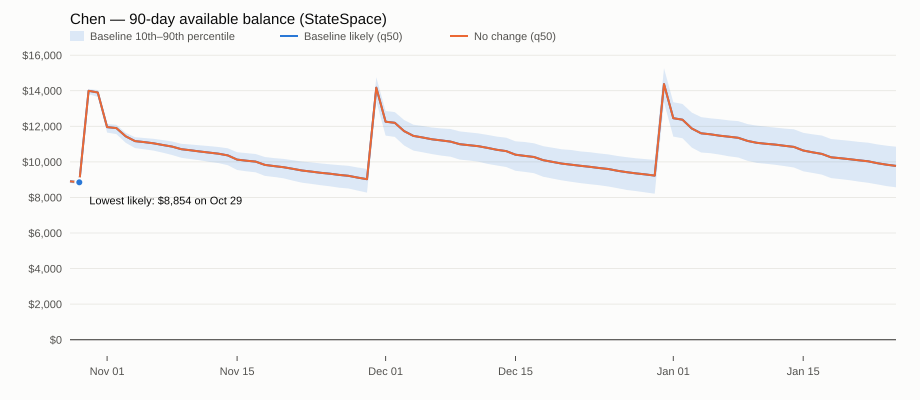

| Lever | Tier | Method | Lowest true slack | Δ vs baseline | Fees 90d | Bill declines | Gate |
|---|---|---|---:|---:|---:|---:|---|
| Turn on low-balance alert at $150 | Behaviour | Learned | 56.7 | 0.0 | $0 | 0.0 |  |
| Trim shopping by 25% (22% of everyday spend) | Behaviour | Learned | 56.9 | +0.2 | $0 | 0.0 |  |
| Switch on savings-first overdraft order | Product | Exact | 56.7 | 0.0 | $0 | 0.0 |  |
| Fee-free account without courtesy pay | Product | Exact | 56.7 | 0.0 | $0 | 0.0 |  |
| $1,000 personal loan, 12 mo @ 13.99% ($90/mo) | Liquidity | Exact | 55.6 | −1.1 | $0 | 0.0 | PASS payment $90/mo vs half of monthly surplus $115 (surplus $231) |
| Income +10% from day 15 (e.g. extra hours) | Income | Exact | 56.8 | +0.1 | $0 | 0.0 |  |
| STRESS TEST: income −20% (member-agreed, never recommended) *(not surfaced)* | Income | Exact | 42.9 | −13.8 | $0 | 0.0 |  |

Catalogue notes: move_bills: no movable bill falls within 5 days before a payday. move_rent: housing payment already falls within 2 days after a payday. refinance: no outside credit-card debt on file.

## Dee (D) — StateSpace

*New member since June 2026 — about four months of history (thin file).*

- Start balance $1,259, savings $0, average daily spend $61.27.
- Headline slack 30/60/90 d: 24.3 / 27.3 / 30.5 days. Lowest true slack: **14.3** (bad case p10 8.7). Risk days: 0. P(any overdraft): 0%. Expected fees: $0.
- Explanation: Your balance is likely lowest on Nov 12 (about $930, 15.2 days of spending). What pulls it down: insurance $95 on Nov 12. Payday on Nov 13 brings it back.
- **Decision:** Goal already met at baseline (14.3 ≥ 2.0 days) — no lever needed.
- **Waterfall:** 14.3 days baseline → 14.3 days
- **Member sentence:** “You keep about 14.3 days of spending in hand even on your tightest day over the next 90 days — no change needed.”

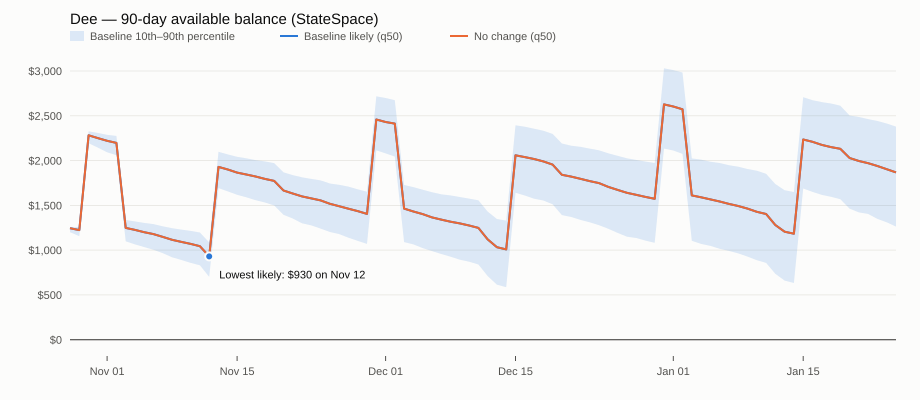

| Lever | Tier | Method | Lowest true slack | Δ vs baseline | Fees 90d | Bill declines | Gate |
|---|---|---|---:|---:|---:|---:|---|
| Move insurance + subscription + phone autopay to the day after payday | Behaviour | Exact | 16.0 | +1.7 | $0 | 0.0 |  |
| Ask to move the rent due date to the day after payday | Behaviour | Exact | 19.7 | +5.4 | $0 | 0.0 |  |
| Turn on low-balance alert at $150 | Behaviour | Learned | 14.3 | 0.0 | $0 | 0.0 |  |
| Trim shopping by 25% (25% of everyday spend) | Behaviour | Learned | 14.6 | +0.4 | $0 | 0.0 |  |
| Fee-free account without courtesy pay | Product | Exact | 14.3 | 0.0 | $0 | 0.0 |  |
| $1,000 personal loan, 12 mo @ 13.99% ($90/mo) | Liquidity | Exact | 13.5 | −0.8 | $0 | 0.0 | PASS payment $90/mo vs half of monthly surplus $92 (surplus $184) |
| Income +10% from day 15 (e.g. extra hours) | Income | Exact | 15.0 | +0.7 | $0 | 0.0 |  |
| STRESS TEST: income −20% (member-agreed, never recommended) *(not surfaced)* | Income | Exact | 1.6 | −12.7 | $29 | 0.0 |  |

Catalogue notes: savings_first: no savings balance to draw on. refinance: no outside credit-card debt on file.

## Eli (E) — StateSpace

*Gig driver paid weekly (Tuesdays) with ±30% swings; $4,200 on an outside card at 27.99% APR.*

- Start balance $502, savings $0, average daily spend $78.10.
- Headline slack 30/60/90 d: 5.9 / 4.2 / 1.6 days. Lowest true slack: **-8.7** (bad case p10 -11.2). Risk days: 52. P(any overdraft): 100%. Expected fees: $276.
- Explanation: Your balance is likely lowest on Nov 01 (about $-661, -8.5 days of spending). What pulls it down: rent $980 on Nov 01. Payday on Nov 03 brings it back.
- **Decision:** Goal not met; best partial plan shown. Structural gap: typical spending exceeds income by $390/month.
- **Waterfall:** -8.7 days baseline → +0.7 (Ask to move the rent due date to the day after payday) → -8.0 days
- **Member sentence:** “If you ask your landlord to move the rent due date to the day after payday (if your landlord agrees), your tightest day over the next 90 days goes from about -8.7 to -8.0 days of spending in hand. Because your usual spending runs about $390 a month above your income, that is still short of the 2-day goal — worth a budget conversation with a specialist.”

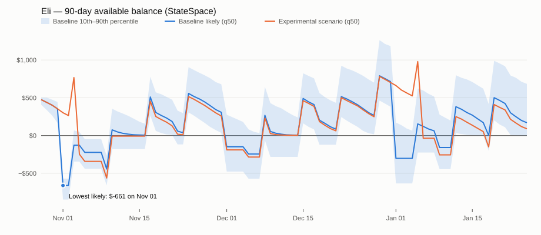

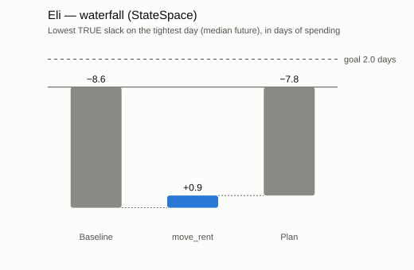

| Lever | Tier | Method | Lowest true slack | Δ vs baseline | Fees 90d | Bill declines | Gate |
|---|---|---|---:|---:|---:|---:|---|
| Move phone + insurance + utilities autopay to the day after payday | Behaviour | Exact | -8.6 | 0.0 | $174 | 0.0 |  |
| Ask to move the rent due date to the day after payday | Behaviour | Exact | -8.0 | +0.7 | $278 | 0.0 |  |
| Turn on low-balance alert at $150 | Behaviour | Learned | -8.6 | 0.0 | $266 | 0.0 |  |
| Trim shopping by 25% (10% of everyday spend) | Behaviour | Learned | -8.6 | 0.0 | $274 | 0.0 |  |
| Fee-free account without courtesy pay | Product | Exact | 0.0 | +8.7 | $0 | 6.9 |  |
| $1,000 personal loan, 12 mo @ 13.99% ($90/mo) | Liquidity | Exact | -14.7 | −6.0 | $140 | 0.0 | FAIL payment $90/mo vs half of monthly surplus $0 (surplus $-390) |
| Refinance $4,200 card debt (27.99% APR) into a 36-mo CU loan @ 11.99%: $168 → $139/mo | Liquidity | Exact | -8.8 | −0.1 | $265 | 0.0 | PASS new payment $139/mo vs current $168/mo |
| Income +10% from day 15 (e.g. extra hours) | Income | Exact | -8.6 | +0.1 | $214 | 0.0 |  |
| STRESS TEST: income −20% (member-agreed, never recommended) *(not surfaced)* | Income | Exact | -9.8 | −1.1 | $434 | 0.0 |  |

Why the other levers were not added:

- `move_bills` — adds only +0.04 days (< 0.1)
- `alerts` — adds only +0.04 days (< 0.1)
- `trim_shopping` — adds only +0.03 days (< 0.1)
- `no_fee_account` — turns fees into ~6.4 declined bill payments per 90 days — needs a member conversation, not auto-adoption
- `cash_loan` — gate failed (cash_loan): payment $90/mo vs half of monthly surplus $0 (surplus $-390)
- `refinance_card` — beats the higher-priority plan by only -0.04 days (< 1.0-day margin)
- `income_up_10` — beats the higher-priority plan by only +0.37 days (< 1.0-day margin)

Catalogue notes: savings_first: no savings balance to draw on.

